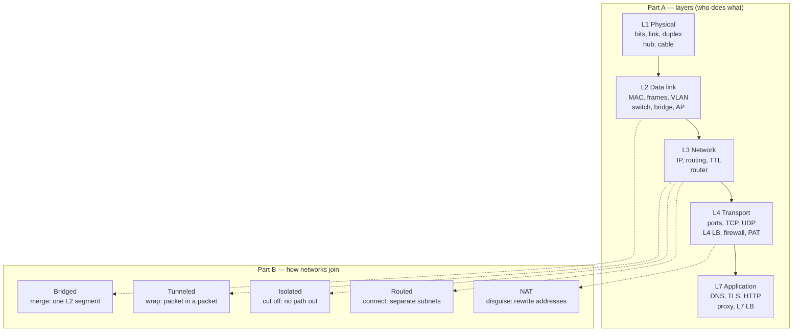

# networking-notes

My personal notes on networking — starting from basic LAN setup and working up through
the layers (L1 → L7) and the ways networks connect (bridged, routed, NAT, isolated, tunneled).
Every note is backed by a **runnable lab** and **real packet captures**.

> **Mental model in three lines**
> **L2 is hop-by-hop, L3/L4 are end-to-end** — anything that breaks that (NAT, proxies, tunnels) is where debugging happens.
> **Bridge** = merge · **Route** = connect · **NAT** = disguise · **Isolate** = cut off · **Tunnel** = wrap.
> **LAN/WAN** = how big · **Topology** = what shape · **Connection mode** = how networks join.

## The big picture



## Notes

### Part A — Layers (bottom-up)

| # | Note | What it covers | Lab highlight |
|---|---|---|---|
| A0 | [Models & encapsulation](notes/00-models-and-encapsulation.md) | OSI vs TCP/IP, PDUs, headers, MTU/MSS, what changes per hop | One real HTTP frame decoded byte by byte |
| A1 | [L1 Physical](notes/01-l1-physical.md) | media, autoneg, duplex, counters, hub vs switch | My 10G NIC negotiated down to 1G |
| A2 | [L2 Data link](notes/02-l2-data-link.md) | frames, MAC learning, flooding, ARP, VLANs, STP | Bystander sees only the ARP broadcast; 802.1Q tag on a trunk |
| A3 | [L3 Network](notes/03-l3-network.md) | IPv4, CIDR, routing, LPM, ICMP, traceroute, PMTUD, IPv6 | Same packet, two links: MACs change, TTL −1, IPs don't |
| A4 | [L4 Transport](notes/04-l4-transport.md) | ports, TCP life cycle & states, refused vs timeout, UDP, QUIC | SYN backoff 1-1-1-1-1-2-4 s; 20 % loss, zero bytes lost |
| A5 | [L7 Application](notes/05-l7-application.md) | DNS, TLS 1.3, HTTP/1.1-2-3, L4 vs L7 LB | HTTPS decrypted with `SSLKEYLOGFILE`; SNI leaks the site |

### Part B — Connection modes

| # | Note | What it covers | Lab highlight |
|---|---|---|---|
| B1 | [Bridged](notes/10-bridged.md) | one broadcast domain, DHCP DORA, STP | One ARP → 3.5 M frames/s without STP |
| B2 | [Routed](notes/11-routed.md) | static/dynamic routes, return path, rp_filter, inter-VLAN | One-way failure; rp_filter dropping at the wrong router |
| B3 | [NAT](notes/12-nat.md) | SNAT/MASQUERADE, PAT, conntrack, DNAT, hairpin | Two hosts, same port → PAT rewrites one; hairpin RST explained |
| B4 | [Isolated](notes/13-isolated.md) | host-only, internal, air-gap, policy isolation | "Isolated" → "NAT mode" is two settings |
| B5 | [Tunneled](notes/14-tunneled.md) | GRE, VXLAN, IPsec/WireGuard, MTU, MSS clamping | Outer vs inner headers; MSS 1460 → 1436 |

### Capstone
- [My network, end to end](notes/99-capstone-my-network.md) — every concept above, found on my own laptop and home network.

## Running the labs

```bash
./labs/run.sh a2-l2            # isolated lab: builds namespaces inside a throwaway container
./labs/run.sh --host a5-l7     # host lab: captures on this machine's real NIC (sanitized)
```
Needs only Docker (no sudo). Details, the full lab list and the privacy rules: [labs/README.md](labs/README.md).

## Repo layout

```
LEARNING-PLAN.md      the plan, module checklist and progress
notes/                one note per module (template below)
labs/                 lab scripts + runner + sanitizer
labs/output/          captured output of the last run of each lab
```

Each note follows the same template: *In one line → How it actually works → Diagram → Concept diagrams (Mermaid) → What I saw in the lab → Gotchas → Checkpoint answer → Open questions.*
