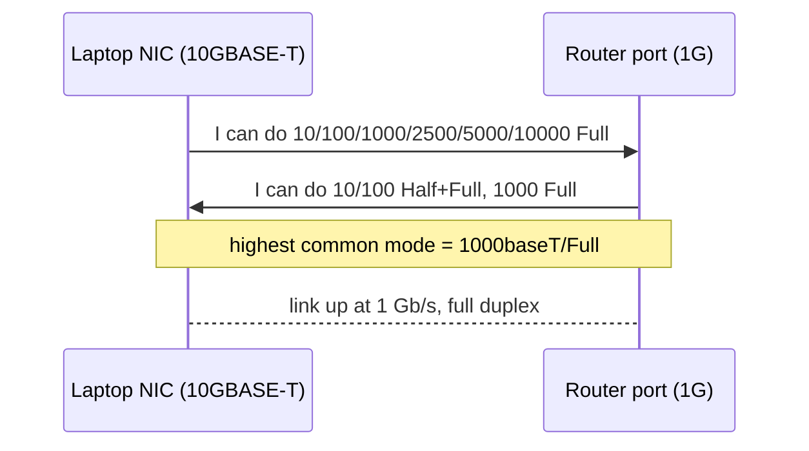
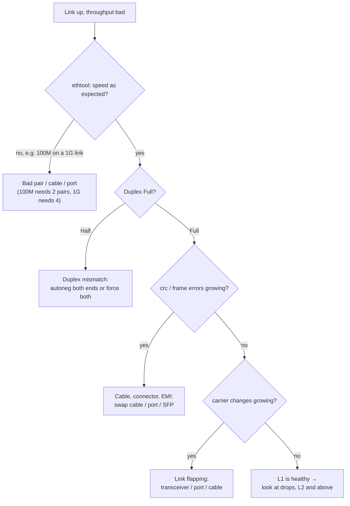

# A1 — L1 Physical

## In one line
L1 moves **bits as signals** over a medium; it has no addresses, but it decides your **speed, duplex and error rate** — so a lot of "the network is slow" problems end here.

## How it actually works

### Media

| Medium | Typical | Notes |
|---|---|---|
| Copper twisted pair (Cat5e/6/6a) | 1G / 2.5G / 10G, ≤ 100 m | RJ45. 10/100 use 2 pairs, **1G+ uses all 4 pairs**. Can carry PoE. |
| Fiber — multimode (MMF) | 1–100G, ~300–500 m | Cheaper optics, inside buildings |
| Fiber — single-mode (SMF) | 1–400G, km+ | Campus/ISP; needs matching SFP optics on both ends |
| Radio (Wi-Fi, 4G/5G) | varies | **Shared, half-duplex** medium — only one talker per channel at a time (CSMA/CA) |

Transceivers (SFP/SFP+/QSFP) are the swappable L1 part on switches: the port is generic, the module decides medium and range.

### Autonegotiation & duplex
- On link-up both ends **advertise** supported modes and pick the highest common one.
- **Full duplex** = send and receive simultaneously (separate pairs/directions). Every modern switched link.
- **Half duplex** = take turns; collisions possible (CSMA/CD). Hubs, ancient links, and *mismatches*.
- **Duplex mismatch** (one side forced to full, the other autonegs and falls back to half) → link is "up", pings work, bulk throughput collapses and late-collision/CRC counters climb.

### What L1 adds that you never see in tcpdump

```
| preamble 7 B | SFD 1 B | ---- frame (dst … FCS), 64–1518 B ---- | inter-frame gap 12 B |
  └── clock sync ──┘                captured by tcpdump (minus FCS)        └── silence ──┘
```
- 20 B of overhead per frame that tools don't show → a 1 Gb/s link carries at most ~**94.9 % useful TCP payload** with 1500 B MTU.
- Minimum frame 64 B: short payloads are padded (originally so collisions could be detected in time).
- FCS (CRC-32) is checked by the NIC: a bad frame is dropped and counted as a **CRC error** — that's your cable/EMI signal.

### Hub vs switch (the L1/L2 line)
- **Hub (L1)** — electrically repeats every bit to every port. One **collision domain**, half duplex for everyone.
- **Switch (L2)** — each port is its own collision domain, full duplex, forwards by MAC. Hubs are effectively extinct; Wi-Fi still behaves like one (shared air).

### Counters worth knowing

| Counter (`ip -s -s link`) | Usually means |
|---|---|
| `crc` / `frame` / `length` | Bad cable, connector, EMI, duplex mismatch |
| `carrier` (TX) | Link flapping — cable/port/transceiver |
| `collsns` | Half duplex in use (should be 0 on switched links) |
| `dropped` | **Not L1** — kernel/driver dropped (queue full, unknown protocol, filtered) |
| `missed` / `fifo` / `overrun` | NIC ring buffer overflowed — host too slow, not the wire |
| `otherhost` | Frames for *other* MACs that reached us (promiscuous mode/flooding) |

## Diagram

```
 laptop NIC (10GBASE-T capable)                       home router port (1G)
 advertises: 10/100/1000/2500/5000/10000 Full   ⇄    advertises: 10/100 Half+Full, 1000 Full
                     └─────── highest common mode = 1000baseT/Full ───────┘
```

## Concept diagrams

### Autonegotiation — the slowest end wins



### "Link is up but slow" — L1 triage



## What I saw in the lab

Lab: [`labs/a1-physical.sh`](../labs/a1-physical.sh) — `./labs/run.sh --host a1-physical`. Output: [`labs/output/a1-physical.txt`](../labs/output/a1-physical.txt).

```
Advertised link modes:  10baseT/Full 100baseT/Full 1000baseT/Full 10000baseT/Full 2500baseT/Full 5000baseT/Full
Link partner advertised link modes:  10baseT/Half 10baseT/Full 100baseT/Half 100baseT/Full 1000baseT/Full
Speed: 1000Mb/s   Duplex: Full   Auto-negotiation: on   Port: Twisted Pair   Link detected: yes
driver: atlantic  (Aquantia/Marvell 10GbE)
```
→ My NIC can do **10G**, the router port tops out at **1G**, autoneg settled on **1000baseT/Full**. The slowest end wins.

```
RX:  bytes 145453877493  packets 105302317  errors 0  dropped 11223  missed 0  mcast 56424
RX errors: length 0  crc 0  frame 0  fifo 0  overrun 0  otherhost 85964087
TX:  bytes 6748799045    packets 45278018   errors 0  dropped 20504  carrier 0  collsns 0
```
- `crc 0`, `frame 0`, `carrier 0`, `collsns 0` → **the physical layer is clean**.
- `dropped` > 0 but `errors` 0 → drops happened in the kernel, not on the wire.
- `otherhost` 86 M — frames not addressed to my MAC still arrived (Docker bridges/VMs put the NIC in promiscuous mode; plus flooded unknown-unicast from the switch). An L2 topic → [A2](02-l2-data-link.md).

veth for comparison: `Speed: 10000Mb/s, Duplex: Full` — a **made-up** value; virtual NICs have no L1, they just copy memory.

## Gotchas / things that surprised me
- "Link up" ≠ healthy. Speed, duplex and CRC counters are the real L1 health check.
- A 1G link that negotiates **100M** often means one damaged pair (100M only needs 2 of the 4 pairs).
- `/sys/class/net/<if>/speed` and `carrier` give the same facts as `ethtool` without any tool — handy in minimal containers.
- **Don't force speed/duplex on one side only.** Either autoneg both or force both.
- Wi-Fi's "link speed" is a PHY rate; real throughput is roughly half of it because the air is shared and half-duplex.

## Checkpoint answer
**Link is up but throughput is terrible — L1 checks:**
1. `ethtool <if>` → negotiated **speed** (100M instead of 1G?) and **duplex** (Half?).
2. Compare with **link partner advertised** modes → is the other end limiting it, or is autoneg off on one side?
3. `ip -s -s link` → are `crc`/`frame` growing? (watch twice, a few seconds apart) → swap cable/port.
4. `carrier` changes → link flapping → transceiver/port/cable.
5. On Wi-Fi: signal strength, channel congestion (`iw dev <if> link`).
6. If all of that is clean → the problem is above L1 (drops in `dropped`/`missed` → host side; otherwise L2+).

## Open questions
- How does 10GBASE-T fit 10 Gb/s down the same 4 pairs as 1G? (PAM-16 encoding + DSP echo cancellation — read later.)
- What exactly causes `dropped` on RX here? → check `ethtool -S` per-queue stats and `nstat` after A2.
