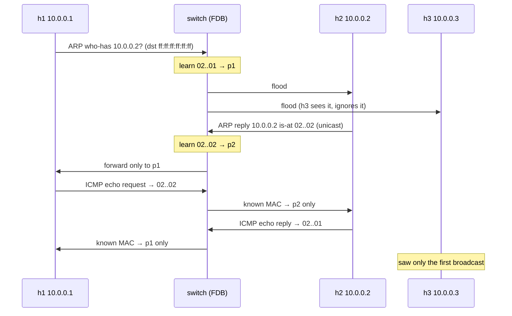
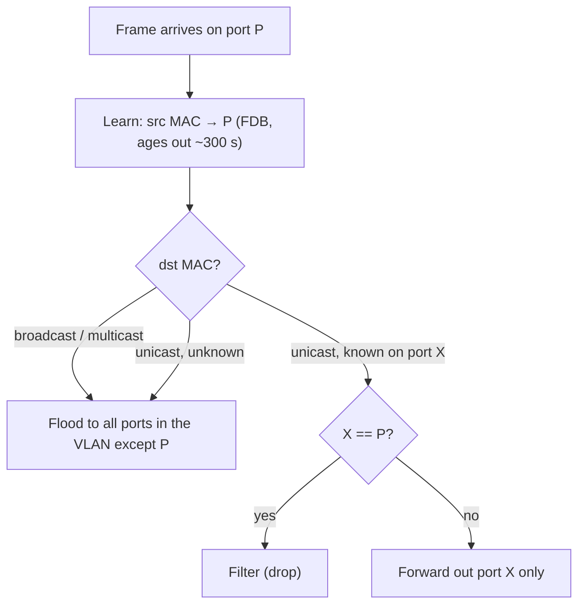
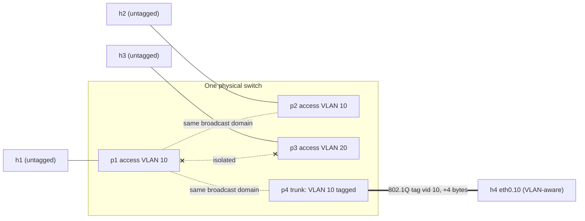

# A2 — L2 Data Link

## In one line
L2 delivers **frames between NICs on the same segment** using MAC addresses; a switch learns where each MAC lives, **floods** what it doesn't know, and ARP glues L3 addresses to L2 ones.

## How it actually works

### Ethernet II frame

```
| dst MAC 6 | src MAC 6 | [802.1Q tag 4] | EtherType 2 | payload 46–1500 | FCS 4 |
```
- **dst first** — so a switch can start forwarding before the whole frame arrives (cut-through).
- **EtherType** says what's inside: `0x0800` IPv4, `0x0806` ARP, `0x86DD` IPv6, `0x8100` = "a VLAN tag follows".
- **MTU 1500** = max payload. Jumbo frames (9000) only work if *every* device on the segment agrees.

### MAC address types

| Kind | How to tell | Example |
|---|---|---|
| Unicast | 1st byte's lowest bit = 0 | `02:00:00:00:00:01` |
| Multicast | lowest bit = 1 | `01:00:5e:…` (IPv4 mcast), `33:33:…` (IPv6) |
| Broadcast | all ones | `ff:ff:ff:ff:ff:ff` |
| Locally administered | 2nd-lowest bit of 1st byte = 1 (`x2`, `x6`, `xA`, `xE`) | VMs, containers, randomised Wi-Fi MACs |

### How a switch forwards
1. **Learn**: frame arrives on port P with src MAC S → record `S → P` in the **FDB / CAM table** (ages out, ~300 s).
2. **Forward**: look up dst MAC D.
   - known → send out **that one port** only
   - unknown unicast, broadcast, multicast → **flood** out of every port except the one it came in on
3. Never send a frame back out the port it arrived on (filter).

### Collision domain vs broadcast domain
- **Collision domain** — who shares the wire at L1. Switch: one per port. Hub/Wi-Fi channel: everyone.
- **Broadcast domain** — who receives an `ff:ff:…` frame. **All ports of a switch (per VLAN).** Only a **router** (or a VLAN boundary) ends it.
- **Broadcast domain ≈ subnet ≈ VLAN** — in a sane design these are 1:1.

### ARP (IPv4 → MAC)
1. h1 wants 10.0.0.2 and has no cache entry → **broadcast**: "who-has 10.0.0.2 tell 10.0.0.1".
2. Everyone in the broadcast domain receives it; only 10.0.0.2 answers — **unicast** reply "10.0.0.2 is-at 02:…:02".
3. h1 caches it (`ip neigh`: REACHABLE → STALE → re-validate); the target also learns h1 from the request itself.
4. **Off-subnet destination?** h1 ARPs for the **gateway's** IP, never the remote host's ([A3](03-l3-network.md)).
- **Gratuitous ARP** — an unsolicited announcement of your own IP→MAC. Used on IP takeover/failover (keepalived, VRRP), after a MAC change, and for duplicate-IP detection. Also exactly what **ARP spoofing** abuses: ARP has no authentication.
- IPv6 replaces ARP with **NDP** (ICMPv6 neighbor solicitation to a multicast group, not broadcast).

### VLANs (802.1Q)
- Split one physical switch into several **isolated broadcast domains**.
- 4-byte tag inserted after src MAC: TPID `0x8100` + PCP (priority, 3 bits) + **VID** (12 bits → 4094 usable VLANs).
- **Access port** — belongs to one VLAN (PVID), frames leave **untagged**; the end host doesn't know VLANs exist.
- **Trunk port** — carries many VLANs, frames are **tagged** so the other end knows which is which (switch↔switch, switch↔router, switch↔hypervisor).
- **Native VLAN** — the one VLAN allowed untagged on a trunk (source of "VLAN hopping" misconfigs).
- Getting **between** VLANs requires L3 → a router or L3 switch ([B2](11-routed.md)).

### STP (why loops kill L2)
- Ethernet has **no TTL**. A broadcast entering a loop circulates forever and multiplies → **broadcast storm**; MAC tables flap as the same src MAC appears on two ports.
- **Spanning Tree Protocol** (802.1D; RSTP 802.1w) elects a root bridge and **blocks** redundant ports so the active topology is a tree; unblocks them on failure.
- Seen in Linux: `ip link set br0 type bridge stp_state 1`.

## Diagram

```
                     ┌──────────────── br0 (switch) ────────────────┐
                     │  FDB: 02:..:01 → p1   02:..:02 → p2           │
                     │   p1 [VLAN10]   p2 [VLAN10]   p3 [VLAN20]   p4 [trunk: 10 tagged]
                     └────┬─────────────┬─────────────┬─────────────┬┘
                         h1 .1         h2 .2         h3 .3         h4 .4 (eth0.10)
   ARP broadcast from h1 ──► p2, p4  (same VLAN)  ✗ p3 (other VLAN)
```

## Concept diagrams

### ARP + switch learning (h1 pings h2, h3 is a bystander)



### How a switch decides where a frame goes



### VLANs: access vs trunk



## What I saw in the lab

Lab: [`labs/a2-l2.sh`](../labs/a2-l2.sh) — `./labs/run.sh a2-l2`. Output: [`labs/output/a2-l2.txt`](../labs/output/a2-l2.txt). MACs are set by the lab (`02:00:00:00:00:0N` = host hN).

### Flooding vs learning — h1 pings h2; h3 is a bystander
On **h3**:
```
02:00:00:00:00:01 > ff:ff:ff:ff:ff:ff, ethertype ARP (0x0806), length 42: Request who-has 10.0.0.2 tell 10.0.0.1
```
That's **all** h3 ever saw. On **h2** (the target):
```
02:..:01 > ff:ff:ff:ff:ff:ff, ARP, Request who-has 10.0.0.2 tell 10.0.0.1
02:..:02 > 02:..:01,          ARP, Reply 10.0.0.2 is-at 02:00:00:00:00:02
02:..:01 > 02:..:02,          IPv4, 10.0.0.1 > 10.0.0.2: ICMP echo request
02:..:02 > 02:..:01,          IPv4, 10.0.0.2 > 10.0.0.1: ICMP echo reply
```
→ The broadcast ARP was **flooded** (h3 got it). By the time the reply came back, the bridge had learned both MACs, so the reply and both ICMPs went **only** to the right port.

```
bridge fdb:   02:00:00:00:00:01 dev p1     02:00:00:00:00:02 dev p2      (learned)
h1 ip neigh:  10.0.0.2 dev eth0 lladdr 02:00:00:00:00:02 REACHABLE
```

### Gratuitous ARP (`arping -U` from h3), seen on h1
```
02:00:00:00:00:03 > ff:ff:ff:ff:ff:ff, ARP, Request who-has 10.0.0.3 (ff:ff:ff:ff:ff:ff) tell 10.0.0.3
```
Sender IP = target IP: "I am 10.0.0.3, update your caches."

### VLANs on the same bridge
```
p1  10 PVID Egress Untagged
p2  10 PVID Egress Untagged
p3  20 PVID Egress Untagged
h1 -> h2 (VLAN 10): 0% packet loss
h1 -> h3 (VLAN 20): 100% packet loss
frames h3 saw: 0
```
→ Same switch, same subnet numbers, but h3 is now in another broadcast domain: it doesn't even receive h1's ARP.

### Trunk vs access — same ping, two vantage points
On h4's **trunk** (`eth0`, VLAN-aware via `eth0.10`):
```
02:..:01 > ff:ff:ff:ff:ff:ff, ethertype 802.1Q (0x8100), length 46: vlan 10, p 0, ethertype ARP, Request who-has 10.0.0.4
02:..:01 > 02:..:04,          ethertype 802.1Q (0x8100), length 102: vlan 10, p 0, ethertype IPv4, ICMP echo request
```
On h1's **access** port:
```
02:..:01 > 02:..:04, ethertype IPv4 (0x0800), length 98: 10.0.0.1 > 10.0.0.4: ICMP echo request
```
→ Identical frame, **+4 bytes** (98 → 102) on the trunk: the 802.1Q tag. The access host never sees it.

## Gotchas / things that surprised me
- The **first** packet to a new neighbour costs an ARP round trip; that's why the first ping is often slower.
- A switch learns from the **source** MAC — so the reply is what teaches it where the requester lives.
- Bystanders see **broadcasts and unknown-unicast floods**, not normal unicast. If you can capture someone else's unicast on a switch, the FDB is missing an entry (or it's a hub / mirror port / Wi-Fi).
- VLAN membership is a property of the **switch port**, not the host. Moving h3 needed zero changes on h3.
- Docker's `docker0` and VirtualBox "Bridged" are this exact Linux bridge mechanism ([B1](10-bridged.md)).
- `ip link` on many Linux hosts shows `master br0` / `master docker0` — that's "this interface is a switch port now".

## Checkpoint answer
**Host A pings B on the same subnet (cold caches) — every frame, in order:**
1. A → `ff:ff:ff:ff:ff:ff` **ARP request** "who-has B tell A" — switch learns A's port, floods to all ports in the VLAN.
2. B → A **ARP reply** (unicast) — switch learns B's port, forwards only to A's port. B also cached A from the request.
3. A → B **ICMP echo request** (IPv4, unicast both at L2 and L3).
4. B → A **ICMP echo reply**.
Later pings: just 3 & 4 until the ARP entry goes STALE and is re-validated (a unicast ARP probe).

## Open questions
- What happens when the FDB is full (MAC flooding attack)? → switch falls back to flooding everything = hub. Defence: port security.
- How do switches in a stack/MLAG avoid STP blocking half the links? → revisit if needed.
