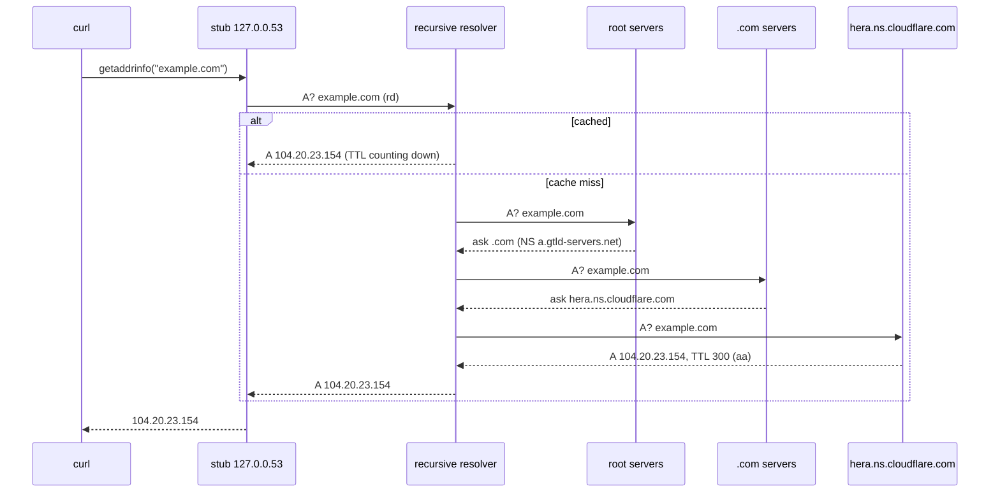
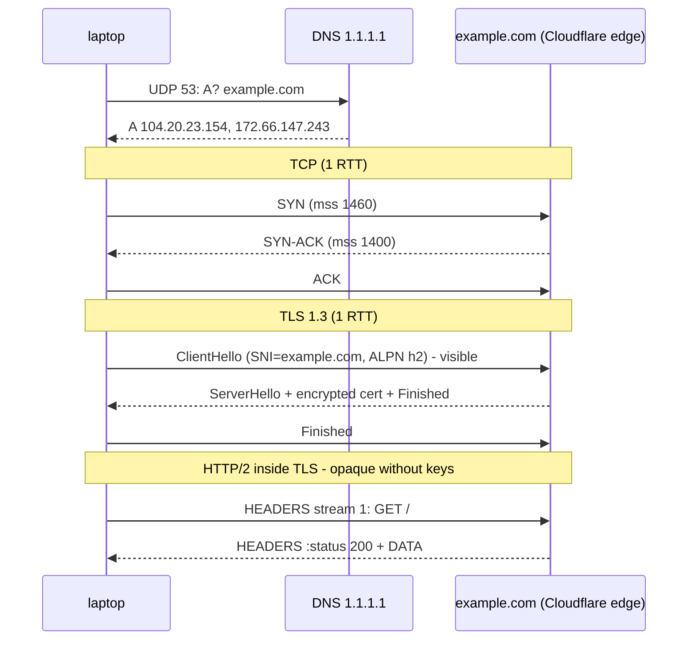
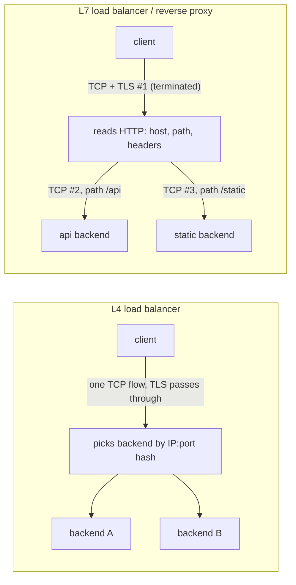

# A5 — L7 Application (+ the fuzzy middle)

## In one line
L7 is what the program actually says (DNS questions, HTTP requests); between it and TCP sits **TLS**, which hides the content from the network but still leaks *who* you're talking to.

## How it actually works

### DNS resolution path

```
 app ──getaddrinfo()──▶ stub resolver (/etc/resolv.conf → 127.0.0.53 systemd-resolved)
                              │ cache miss
                              ▼
                     recursive resolver (router, ISP, 1.1.1.1, 8.8.8.8)
                              │ cache miss — iterates:
             ┌────────────────┼──────────────────────┐
             ▼                ▼                      ▼
        root servers  →  .com TLD servers  →  example.com's authoritative NS
        "ask .com"       "ask hera.ns.cloudflare.com"  "A 104.20.23.154"
```
- **Stub** asks one question and expects a final answer (`rd` = recursion desired). **Recursive resolver** does the walking and caches by **TTL**.
- Records: `A` (IPv4), `AAAA` (IPv6), `CNAME` (alias), `NS` (delegation), `MX` (mail), `TXT`, `SOA`, `PTR` (reverse), `SRV`, `HTTPS/SVCB` (advertises ALPN/h3).
- Transport: **UDP 53** normally; **TCP 53** for big answers (truncated `TC` flag) and zone transfers. Encrypted: **DoT** (TCP 853), **DoH** (HTTPS 443).
- Response flags: `qr` response · `aa` authoritative · `rd`/`ra` recursion desired/available · `ad` DNSSEC-validated.

### TLS (1.3) handshake — where it sits, what it hides

```
 TCP established
 Client ── ClientHello: SNI=example.com, ALPN=[h2,http/1.1], key share ──▶     (cleartext)
        ◀── ServerHello: chosen cipher + key share ─────────────────────── Server   (cleartext)
        ◀── {EncryptedExtensions, Certificate, CertificateVerify, Finished}       (encrypted)
 Client ── {Finished} + first HTTP request ──────────────────────────────▶       1 RTT total
```
- TLS 1.3: **1 RTT** (TLS 1.2 needed 2); 0-RTT resumption possible.
- **Visible to the network**: dst IP, port 443, **SNI** (hostname), ALPN (protocol), cert in TLS 1.2 (encrypted in 1.3), packet sizes and timing.
- **Hidden**: URL path, headers, cookies, body, response.
- **ECH** (Encrypted Client Hello) hides SNI too — still rolling out.
- Certificate chain: leaf (`CN=example.com`) → intermediate(s) → root in the client's trust store. The server sends leaf + intermediates; the root must already be trusted locally.

### HTTP versions

| | HTTP/1.1 | HTTP/2 | HTTP/3 |
|---|---|---|---|
| Transport | TCP (+TLS) | TCP + TLS (ALPN `h2`) | **QUIC over UDP** (ALPN `h3`) |
| Format | text | binary frames | binary frames |
| Requests per connection | one at a time (pipelining unused) | **many streams multiplexed** | many streams, independent |
| Head-of-line blocking | per connection | at **TCP** level (one lost packet stalls all streams) | none between streams |
| Header compression | none | HPACK | QPACK |
| Discovery | — | ALPN in ClientHello | `Alt-Svc: h3=":443"` header or DNS `HTTPS` record |

### L4 vs L7 load balancers / proxies

| | L4 LB | L7 LB / reverse proxy |
|---|---|---|
| Sees | IP + port (+ TCP flags) | full HTTP: host, path, headers, cookies |
| Decides by | 5-tuple hash, least connections | URL path, host, header, cookie, weight |
| TLS | passes through (or terminates without reading HTTP) | **terminates** TLS to read HTTP |
| Connection | client ↔ backend is one TCP flow (or NATed) | **two** connections: client↔proxy, proxy↔backend |
| Client IP at backend | preserved (DSR/transparent) or lost via SNAT | via `X-Forwarded-For` / PROXY protocol |
| Examples | AWS NLB, IPVS, MetalLB, HAProxy `mode tcp` | nginx, Envoy, HAProxy `mode http`, AWS ALB, Cloudflare |

## Diagram — one `curl https://example.com`

```
 t=0       DNS   A? example.com → 1.1.1.1          ── UDP 53 ──   A 104.20.23.154, 172.66.147.243
 +0 ms     (ARP for gateway — already cached)
 +11 ms    TCP   SYN → SYN-ACK → ACK               ── 1 RTT ──    (tcp 0.011 s)
 +29 ms    TLS   ClientHello(SNI) → ServerHello…   ── 1 RTT ──    (tls 0.029 s)
 +45 ms    HTTP/2  GET /  →  :status 200           ── 1 RTT ──    (first byte 0.045 s)
```

## Concept diagrams

### DNS resolution



### One `curl https://example.com`, end to end



### L4 vs L7 load balancer



## What I saw in the lab

Lab: [`labs/a5-l7.sh`](../labs/a5-l7.sh) — `./labs/run.sh --host a5-l7`. Output: [`labs/output/a5-l7.txt`](../labs/output/a5-l7.txt).
(Host capture filtered to example.com / 1.1.1.1 only; MACs and my public IP are sanitized by [`labs/sanitize.pl`](../labs/sanitize.pl).)

### DNS
```
;; flags: qr rd ra ad; QUERY: 1, ANSWER: 2
example.com.  139  IN  A  172.66.147.243
example.com.  139  IN  A  104.20.23.154
;; Query time: 11 msec
```
`dig +trace` (root → TLD → authoritative):
```
.             IN NS  a.root-servers.net.
com.          IN NS  a.gtld-servers.net.
example.com.  IN NS  hera.ns.cloudflare.com.
example.com.  300 IN A 104.20.23.154
```
→ TTL 139 at 1.1.1.1 vs 300 at the authoritative server: the resolver's cached copy is **counting down**.

### The whole request on the wire (no keys)
```
1   192.168.1.9    → 1.1.1.1         DNS      Standard query A example.com
2   1.1.1.1        → 192.168.1.9     DNS      response A 104.20.23.154 A 172.66.147.243
3   192.168.1.9    → 172.66.147.243  TCP      33400 → 443 [SYN] MSS=1460
4   172.66.147.243 → 192.168.1.9     TCP      443 → 33400 [SYN, ACK] MSS=1400
6   192.168.1.9    → 172.66.147.243  TLSv1    Client Hello (SNI=example.com)
8   172.66.147.243 → 192.168.1.9     TLSv1.3  Server Hello, Change Cipher Spec, Application Data
10  192.168.1.9    → 172.66.147.243  TLSv1.3  Change Cipher Spec, Application Data
11… …                                TLSv1.3  Application Data  (×10 — opaque)
```
```
ClientHello:  SNI=example.com   ALPN offered=h2,http/1.1   versions=0x0304 (1.3), 0x0303 (1.2)
ServerHello:  cipher=0x1302 (TLS_AES_256_GCM_SHA384)   chosen version=0x0304 (TLS 1.3)
curl timings: tcp 0.011 s   tls 0.029 s   first-byte 0.045 s   → HTTP/2 200
```

### Same capture, decrypted with curl's `SSLKEYLOGFILE`
```
stream 1: GET / authority=example.com
stream 1: status 200
```
→ All those "Application Data" records were HTTP/2 frames. Without the keys, an observer sees **only** the SNI, sizes and timing.

### Certificate chain
```
0 s:CN=example.com                         i:Cloudflare TLS Issuing ECC CA 3
1 s:Cloudflare TLS Issuing ECC CA 3        i:SSL.com TLS Transit ECC CA R2
2 s:SSL.com TLS Transit ECC CA R2          i:SSL.com TLS ECC Root CA 2022
3 s:SSL.com TLS ECC Root CA 2022           i:AAA Certificate Services (Comodo)   ← cross-signed for old clients
```

### HTTP versions & headers
```
--http1.1 → 1.1 200      --http2 → 2 200      --http3 → not supported by this curl build
HTTP/2 200 · server: cloudflare · age: 3928 · alt-svc: h3=":443"; ma=86400
```
→ `alt-svc` is the server advertising HTTP/3 ("try QUIC on UDP 443 for the next 24 h"). `age` = seconds the response sat in Cloudflare's cache: an **L7 proxy** answered, not example.com's origin.

## Gotchas / things that surprised me
- **`example.com` is behind Cloudflare** — the IP I connect to is an L7 reverse proxy / CDN edge; two A records = anycast front doors.
- The ClientHello shows as **"TLSv1"** in tshark: the record-layer version field is frozen at 1.0/1.2 for middlebox compatibility; the real version is negotiated in the `supported_versions` extension (`0x0304`).
- "Change Cipher Spec" in TLS 1.3 is a dummy message, also only for middlebox compatibility.
- `dig` with no `@server` goes to **127.0.0.53** (systemd-resolved) — the stub on the laptop, not the real resolver. To see the real DNS traffic, query a resolver explicitly or capture on the WAN-facing NIC.
- `SSLKEYLOGFILE` works with curl, Firefox and Chrome → decrypt your own traffic in Wireshark. It's the way to debug HTTPS without a MITM proxy.
- TTFB ≈ 4 RTTs from cold (DNS + TCP + TLS + HTTP). Connection reuse, TLS resumption and HTTP/3 each cut one.

## Checkpoint answer
**`curl https://example.com` end to end:**
1. **DNS** — libc → stub (127.0.0.53) → recursive resolver over UDP 53 → `A 104.20.23.154` (cached by TTL).
2. **Routing decision** — 104.20.23.154 isn't on my /24 → next hop = default gateway 192.168.1.1.
3. **ARP** — gateway's MAC (normally already cached; otherwise broadcast who-has 192.168.1.1).
4. **TCP** — SYN / SYN-ACK / ACK to port 443 (MSS 1460 ↔ 1400). Router NATs my 192.168.1.9 to its public IP on the way out.
5. **TLS 1.3** — ClientHello (SNI=example.com, ALPN h2) → ServerHello + encrypted cert → Finished. Keys derived; everything after is opaque.
6. **HTTP/2** — `GET /` on stream 1 → `:status 200` (served from Cloudflare's cache, `age: 3928`).
7. **Teardown** — connection kept alive briefly, then FIN/FIN (or reused for the next request).

## Open questions
- Build curl with HTTP/3 (or use `quiche-client`) and capture QUIC — what's still visible? (SNI in the Initial packet, protected only by a well-known key.)
- DoH in the browser bypasses 127.0.0.53 entirely — how do enterprise networks still enforce DNS policy?
