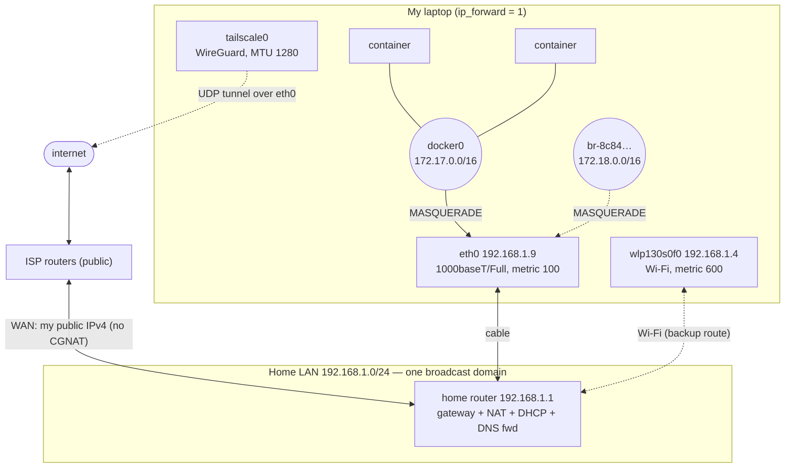
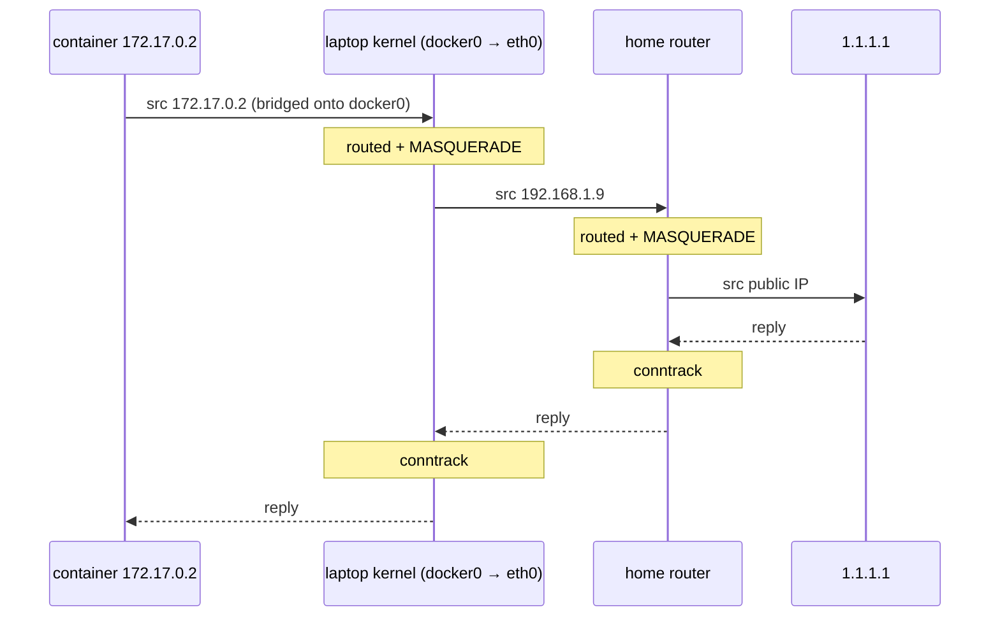

# Capstone — My Network, End to End

## In one line
My laptop is itself a small network: **two NICs on the home LAN, two Docker bridges with NAT, a WireGuard (Tailscale) tunnel**, and behind the home router one more NAT before the ISP — every concept from A0–B5 is running on this one machine.

## The map

```
                                                    ┌──────────── ISP ─────────────┐
                                                    │ hop 2, 3, 4: public routers   │──▶ internet (1.1.1.1)
                                                    └──────────────▲───────────────┘
                                                                   │  WAN: my public IP (single NAT, no CGNAT)
 ┌─────────────────────────── home router 192.168.1.1 (02:..:02) ──┴────────────────────────────────┐
 │  L3 gateway + NAT (MASQUERADE LAN→WAN) + DHCP + DNS forwarder                                        │
 │  L2: LAN switch ports + Wi-Fi radio bridged into ONE broadcast domain (192.168.1.0/24)              │
 └──────────────┬──────────────────────────────────────────┬─────────────────────────────────────────────┘
          cable │ 1000baseT/Full                      Wi-Fi │
 ┌──────────────┴──────────────── my laptop ─────────────────┴──────────────────────────────────────┐
 │  eth0 (02:..:01)  192.168.1.9 (+ .240–.252 aliases)   metric 100  ◀── wins the default route     │
 │  wlp130s0f0 (02:..:03) 192.168.1.4 (DHCP)              metric 600  ◀── backup default            │
 │                                                                                                    │
 │  ip_forward = 1  (Docker turns it on)                                                              │
 │  docker0          172.17.0.0/16  bridge, 2 ports   ── MASQUERADE ! -o docker0 ──▶ out via eth0     │
 │  br-8c847a550577  172.18.0.0/16  bridge, 0 ports (compose network, linkdown)                       │
 │  tailscale0       MTU 1280       WireGuard tunnel (L3 overlay)                                     │
 │  gre0 / gretap0 / erspan0        fallback devices created when the ip_gre module loaded (B5 lab)  │
 │  DNS: 127.0.0.53 (systemd-resolved stub) → upstream resolver                                       │
 └────────────────────────────────────────────────────────────────────────────────────────────────────┘
```

## Layer by layer

| Layer | On my machine | Evidence |
|---|---|---|
| **L1** | 10GBASE-T NIC (atlantic) negotiated down to **1G full** by the router port; clean counters | [A1](01-l1-physical.md), `ethtool eth0` |
| **L2** | eth0 and Wi-Fi in the **same broadcast domain** — both see the router at the same MAC `02:..:02` | `ip neigh show 192.168.1.1` (two entries, one MAC) |
| **L2 (virtual)** | `docker0` and `br-…` are Linux bridges (STP off) — containers are switch ports | [B1](10-bridged.md), `/sys/class/net/*/bridge` |
| **L3** | two default routes; **lowest metric wins** → eth0. 13 alias IPs on eth0 (.240–.252) | `ip route`, `ip route get 1.1.1.1` |
| **L3/L4 NAT** | Docker masquerades 172.17/16 and 172.18/16; the home router masquerades 192.168.1/24 | [B3](12-nat.md), `iptables -t nat -S POSTROUTING` |
| **Tunnel** | tailscale0, MTU **1280** (WireGuard overhead + IPv6 minimum MTU) | [B5](14-tunneled.md) |
| **L7** | stub resolver 127.0.0.53 → upstream; HTTPS with SNI visible on the wire | [A5](05-l7-application.md) |

## The path of one packet: a Docker container → 1.1.1.1

| Hop | Mode | What changes |
|---|---|---|
| container eth0 → `docker0` | **bridged** (veth → bridge port) | nothing — same 172.17/16 segment |
| `docker0` → eth0 (host kernel) | **routed** (ip_forward=1) + **NAT** (MASQUERADE) | src `172.17.0.x` → `192.168.1.9`; new MACs; TTL −1 |
| eth0 → home router | L2 hop on the home LAN | dst MAC = router `02:..:02` |
| home router → ISP | **routed** + **NAT** again | src `192.168.1.9` → my public IP; TTL −1 |
| ISP → … → 1.1.1.1 | **routed** (BGP-learned paths) | MACs every hop, TTL −1 every hop |

→ A container's packet is **NATed twice** (Docker, then the home router) before it reaches the internet. Replies are un-NATed twice via two independent conntrack tables.

## Concept diagrams

### My network as a graph



### A container's packet is NATed twice



## What I saw in the lab

Lab: [`labs/c0-capstone.sh`](../labs/c0-capstone.sh) — `./labs/run.sh --host c0-capstone`. Output: [`labs/output/c0-capstone.txt`](../labs/output/c0-capstone.txt).
(MACs, my public IPv4 and IPv6 prefix are sanitized; hops beyond the router are printed as a category only.)

```
default via 192.168.1.1 dev eth0 proto static metric 100
default via 192.168.1.1 dev wlp130s0f0 proto dhcp src 192.168.1.4 metric 600
route get 1.1.1.1 → via 192.168.1.1 dev eth0 src 192.168.1.9

192.168.1.1 dev wlp130s0f0 lladdr 02:00:00:00:00:02 REACHABLE
192.168.1.1 dev eth0       lladdr 02:00:00:00:00:02 REACHABLE

-A POSTROUTING -s 172.17.0.0/16 ! -o docker0 -j MASQUERADE
-A POSTROUTING -s 172.18.0.0/16 ! -o br-8c847a550577 -j MASQUERADE
ip_forward = 1

  1  192.168.1.1    private (RFC 1918)
  2  <isp-public>   public ISP router
  3  <isp-public>   public ISP router
hop 2 is a public ISP router → single NAT at my home router (public IP is mine)
```

## Gotchas / things I learned about my own setup
- **Two NICs on one subnet** — both get a connected route for 192.168.1.0/24 and a default route; the kernel picks by **metric**. If the cable drops, traffic fails over to Wi-Fi (metric 600) automatically. But return traffic for 192.168.1.4 can still arrive on eth0 (the "ARP flux" problem): Linux answers ARP for any local IP on any interface by default (`arp_ignore=0`).
- **Docker silently made my laptop a router** (`ip_forward = 1`). Any device on the LAN that routes 172.17.0.0/16 to me could reach my containers — the `DOCKER` / `DOCKER-USER` filter chains are what stop that.
- The Wi-Fi interface's MTU is 1492 while eth0 is 1500 — the same LAN, different MTUs; PMTUD/MSS handle it.
- `tailscale0` MTU 1280: the overlay picks the IPv6 minimum MTU so it works over any path, at the cost of more packets.
- The `gre0`/`gretap0`/`erspan0` devices appeared after the B5 lab loaded `ip_gre` — kernel modules create fallback tunnel devices in every namespace.
- My ISP gives me a real public IPv4 (no CGNAT) — so port-forwarding on the home router *would* work from the internet.

## Checkpoint answer
**How does a packet from my laptop reach the internet and back?**
Laptop picks eth0 (lowest metric) → ARPs (cached) for 192.168.1.1 → frame to the router's MAC → router routes it to the ISP and **MASQUERADEs** 192.168.1.9 to my public IP, recording the flow in conntrack → the ISP routes by BGP toward 1.1.1.1, rewriting MACs and decrementing TTL each hop → the reply comes back to my public IP → the router's conntrack maps it back to 192.168.1.9:port → delivered over the LAN to eth0. From a container, the same thing happens with one extra bridge + NAT layer on the laptop itself.

## Open questions
- What does the home router's own NAT table look like — and can I see its conntrack (many routers expose it in a diagnostics page)?
- Which upstream resolver does systemd-resolved actually use? (`resolvectl status`.)
- IPv6: the host has global IPv6 addresses — so IPv6 traffic reaches the internet **without NAT**. Is the router's IPv6 firewall actually blocking inbound?
